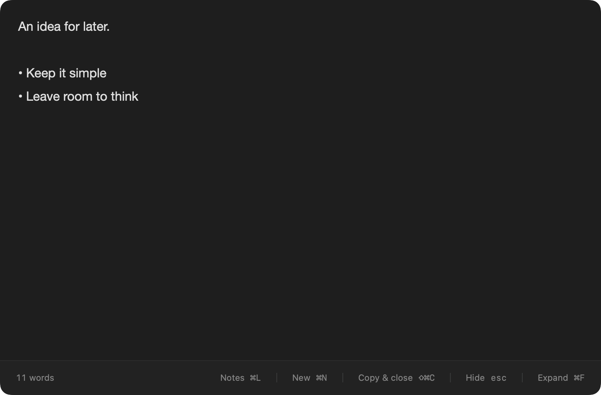
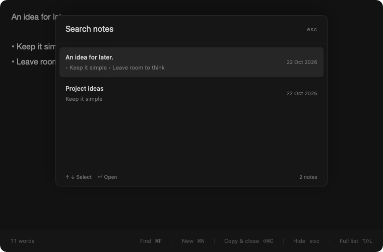

# Drafts

A little room to think. A minimal, dark, translucent scratchpad that floats over your work and saves every note on your Mac.

[Download v0.6.1 preview](https://github.com/kush-10/drafts/releases/tag/v0.6.1) · [Installation](#install) · [Shortcuts](#shortcuts) · [Build from source](#build-from-source)

**macOS 14+ · Apple Silicon + Intel · MIT licensed**



## Install

1. Download **[Drafts-0.6.1-universal.dmg](https://github.com/kush-10/drafts/releases/download/v0.6.1/Drafts-0.6.1-universal.dmg)** from the [official release](https://github.com/kush-10/drafts/releases/tag/v0.6.1).
2. Open the disk image and drag **Drafts** into **Applications**.
3. Eject the disk image, then open Drafts from Applications.
4. Press **⌥Space** to open the notepad; press it again to save and hide. There is **no Dock icon**; Drafts normally lives in the menu bar.

A [ZIP download](https://github.com/kush-10/drafts/releases/download/v0.6.1/Drafts-0.6.1-universal.zip) is available too: extract it, move `Drafts.app` into Applications, then open it. GitHub’s automatically generated **Source code** archives are not app installers.

### First-launch security warning

> **This is an early preview, ad-hoc signed and not Apple-notarized.** macOS may block its first launch. This is not a Developer ID signed or App Store approved release.

If macOS says it cannot verify the developer or check the app for malicious software, and you trust the official download:

1. First try opening Drafts from Applications.
2. Open **System Settings → Privacy & Security**.
3. Find the message about Drafts and click **Open Anyway**, then confirm **Open**. Administrator authentication may be required.

Do **not** disable Gatekeeper globally, bypass a managed Mac’s restrictions, or ignore an actual malware or damaged/modified-app warning. Some macOS versions or organizational policies may not offer an override for ad-hoc builds; in that case, [build from source](#build-from-source) or wait for a Developer ID signed and notarized release.

### Verify a download

Download `SHA256SUMS.txt` from the same release. In Terminal, run this in the folder containing the DMG and compare its hash with the matching line in that file:

```sh
shasum -a 256 Drafts-0.6.1-universal.dmg
```

The release also includes `release-info.json`, which states the version, architectures, signing type, and notarization status. Checksums detect mismatched downloads; they are not an independent developer identity or a replacement for notarization.

## Just a notepad

- A dark, translucent floating editor with no sidebar or formatting toolbar.
- Automatic local saving. Hide and return without losing your draft.
- `⌘F` opens a searchable note picker **inside the same window**.
- Copy the whole draft and close with one shortcut.
- New Note reuses existing blank drafts instead of filling your history with empties.
- A separate table window for browsing, editing, restoring, and deleting notes.
- Basic bold, italic, underline, and bullets. No images, code blocks, checklists, tags, accounts, or sync.



*Screenshots use generated sample notes, not personal data.*

## Shortcuts

| Shortcut | Action |
| --- | --- |
| **⌥Space** | Show the newest surviving note **by creation time** when hidden; save and hide when visible, including the picker. |
| **⌘N** | Open a blank draft, reusing the current or another existing blank. |
| **⇧⌘C** | Copy the whole note as plain text, save, and hide the notepad. |
| **⌘F** | Show the in-window note picker. Type to search, **↑/↓** to select, **Return** to open. |
| **Esc** | Dismiss the picker first; otherwise save and hide the notepad. |
| **⌥⇧L** | Open the separate full-list table editor. |
| **⌘,** | Settings. |
| **⌘B / ⌘I / ⌘U** | Bold / italic / underline. |
| **⇧⌘B** | Toggle bullet points. |

Only Show / hide notepad and Full list are global shortcuts. The others work while using Drafts. Global bindings can be changed in Settings; duplicate bindings and reserved local shortcuts are rejected. Standard undo/redo, cut/copy/paste, select all, and close-window commands remain available. `⌘C` is normal selection copy; `⇧⌘C` copies everything.

Return continues a bullet list. Return on an empty bullet exits it. Clipboard contents are **never imported automatically**; explicit paste keeps basic text styles and ignores images.

### Hide the menu-bar icon

Open **Settings → Hide menu bar icon**. Drafts continues running without a menu-bar or Dock icon. Use **⌥Space**, or reopen Drafts from Applications, then **⌘,** to restore the icon. If a global shortcut cannot register, the menu-bar icon stays visible so you are not locked out.

## Window and note behavior

The notepad has a fixed **760 × 500** size and opens centered on the display containing the pointer. Drag unused bottom-bar space to move it temporarily; Open or New resets its size and position. The full-list editor uses a separate fixed **1000 × 640** content size. Opening the picker does not move or resize anything.

The picker searches note contents, ignoring case and accents and matching every search word. It lists active notes by creation time. Escape or clicking outside returns you to the current text and cursor selection. Selecting an older note does not create a new one. The global shortcut saves and hides whichever note is visible; its next press opens the newest-created note. **Open Note** in the menu and reopening from Applications always open rather than toggle.

Empty and whitespace-only drafts are reusable. New never overwrites nonblank notes, reuses a note from Trash, or removes pre-existing duplicate files. Previously saved rich text and legacy attachments remain preserved. Existing `#text` is ordinary text, not a tag.

The full-list table supports sorting by column, editing a selected row below the table, and double-clicking to open it in the notepad. All / Trash filters provide manual delete and restore. Manual permanent deletion asks for confirmation.

## Storage and privacy

**Everything stays on this Mac.** Drafts has no app networking, accounts, analytics, sync, or clipboard monitoring. It does not require Accessibility permission. Opening the repository or downloading a release in a browser is separate from the app.

Notes are stored in:

```text
~/Library/Application Support/Drafts/Notes/
```

Each note is a JSON file with embedded RTFD for formatting and legacy content. Settings → **Show files** opens the folder. **Back up this folder** for important notes. Storage is not independently encrypted; use FileVault for disk protection.

New notes are saved before opening. Edits save after a short debounce and flush on note/window switches, hide, sleep, and quit. Save failures retain pending edits in memory and prevent silently closing an unsaved draft. Unreadable files are left untouched.

### Keep everything, or auto-delete

Settings → Note storage has two choices:

- **Keep everything** (default): nothing is automatically deleted, including Trash.
- **Automatically delete after last edit**: choose a custom number of minutes, hours, or days. Expired notes are **permanently deleted, including Trash**. There is no separate Trash timer or per-note exemption.

The open notepad and a note actively being edited in the table are protected while in use. Hiding an already-expired note can delete it immediately. Copying or reopening does not reset its last-edit time. The cleaner checks on launch, on hide, and every 30 seconds while Drafts runs, and pauses while Settings is open. It does not delete pending changes if saving fails.

Upgrading from the older Trash-based cleanup policy preserves the interval but leaves permanent auto-deletion **off** until explicitly enabled.

## Update or uninstall

To update, quit Drafts from its menu or with **⌘Q**, then replace the app in Applications with the new download. There is no automatic updater. Notes and preferences remain separate from the app bundle.

To uninstall, quit Drafts and move it out of Applications. This does **not** remove your saved notes. If you also want to remove them, back them up first and delete the storage folder in Finder yourself.

## Build from source

Requires a Mac with **Xcode 15+ / Swift 5.9+** or its selected command-line tools. No third-party packages, accounts, or API keys are needed.

```sh
git clone https://github.com/kush-10/drafts.git
cd drafts
swift test
./scripts/build-app.sh
open dist/Drafts.app
```

Open `Package.swift` in Xcode, or use `swift run Drafts` for development. Build a universal app with `UNIVERSAL=1 ./scripts/build-app.sh`; generate versioned DMG/ZIP/checksums with `./scripts/package-release.sh`. See [distribution and notarization instructions](docs/DISTRIBUTION.md) for maintainers.

Tests cover persistence, shortcut toggling and save-failure recovery, copy-and-close, blank reuse, picker focus and keyboard navigation, fixed geometry, text wrapping, table editing, safe deletion settings, migration, and menu-bar icon preferences. Optional sample screenshots:

```sh
DRAFTS_PREVIEW_DIRECTORY="$PWD/.build/previews" swift test --filter WorkflowTests/testViewsRenderAtFixedSizes
```

## Feedback and license

Report bugs in [GitHub Issues](https://github.com/kush-10/drafts/issues), with your macOS version, Mac architecture, and reproduction steps. **Do not upload personal note files or signing credentials.** This preview needs broader testing across Spaces, full-screen apps, multiple monitors, Intel hardware, and older supported macOS versions.

[MIT License](LICENSE) · Copyright © 2026 Kushal Patel. Independent of other products named Drafts.
