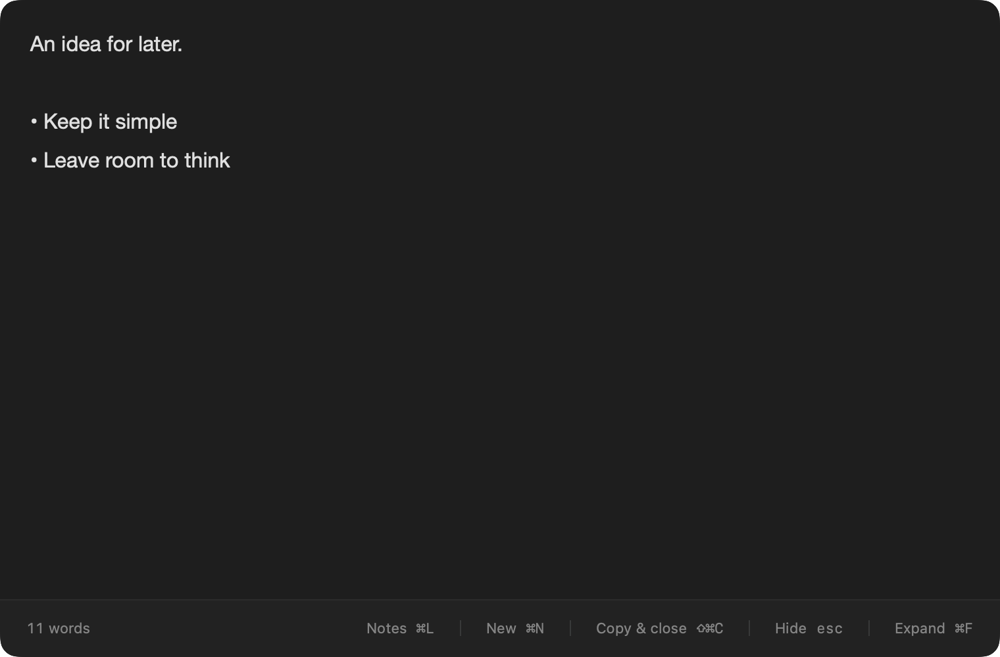

# Drafts

A little room to think. A minimal, translucent scratchpad that floats over your work and saves every note on your Mac.

**macOS 14+ · Apple Silicon + Intel · MIT licensed**

[Download v0.9.1 preview](https://github.com/kush-10/drafts/releases/tag/v0.9.1) · [User guide](docs/GUIDE.md) · [Issues](https://github.com/kush-10/drafts/issues)



## Features

- A floating editor with autosave. Stays open when you switch apps; hide it when you're done.
- Fast text and topic search, plus a notes table with sorting, batch actions, and Trash.
- Basic formatting, custom fonts, and twenty live-preview themes.
- Optional open at startup, managed through macOS Login Items in Settings → General.
- Manual topic assignment with `/Topic`, or optional on-device AI organisation.
- Local-only notes. No accounts, sync, analytics, or clipboard monitoring.

## Install

1. Download [Drafts-0.9.1-universal.dmg](https://github.com/kush-10/drafts/releases/download/v0.9.1/Drafts-0.9.1-universal.dmg).
2. Open it, drag **Drafts** into **Applications**, then launch it.
3. Press **⌥Space** to show the notepad; press again to save and hide. Drafts lives in the menu bar, not the Dock.

**Preview warning:** this release is ad-hoc signed and **not Apple-notarized**. If macOS blocks the official download and you trust it, use **System Settings → Privacy & Security → Open Anyway** after attempting to launch. Never disable Gatekeeper or bypass a managed Mac's restrictions; do not override malware or damaged-app warnings. See the [installation guide](docs/GUIDE.md#install) for details, ZIP downloads, and checksum verification.

## Shortcuts

| Shortcut | Action |
| --- | --- |
| **⌥Space** | Show / save and hide |
| **⌥⇧K** | Search from any app |
| **⌥⇧L** | All notes |
| **⌘N** | New note |
| **⌘K** | Search text and topics |
| **⌘F** | Expand / restore window |
| **⇧⌘C** | Copy whole note, save, and hide |
| **Esc** | Dismiss search, or save and hide |
| **⌘,** | Settings |

Global shortcuts are configurable in Settings. See the [full shortcut reference](docs/GUIDE.md#shortcuts) for formatting and more.

## Local AI and storage

AI topic organisation is optional and requires **Apple Silicon**. Download and select an MLX model in **Settings → Models**; no server or API key is needed. Writing and search work without a model, and note text never leaves your Mac. Network access is only used for model downloads you request.

Notes live in `~/Library/Application Support/Drafts/Notes/`. **Back up the whole folder, including its hidden `.drafts/` subfolder.** Notes are not independently encrypted. Nothing is automatically deleted by default; opt-in retention permanently deletes expired notes, including Trash.

More: [AI topics and models](docs/GUIDE.md#local-ai-topics) · [Storage and privacy](docs/GUIDE.md#storage-and-privacy) · [Update or uninstall](docs/GUIDE.md#update-or-uninstall)

## Build from source

Requires **Swift 6.3+**, a compatible full Xcode installation with developer tools selected, and the **Metal Toolchain** (`xcodebuild -downloadComponent MetalToolchain`).

```sh
git clone https://github.com/kush-10/drafts.git
cd drafts
swift test
./scripts/build-app.sh
open /Applications/Drafts.app
```

The build script installs to `/Applications/Drafts.app`. Model weights are not bundled or downloaded during builds. See the [development reference](docs/GUIDE.md#build-from-source) and [distribution guide](docs/DISTRIBUTION.md) for details.

## Feedback and license

[Report a bug](https://github.com/kush-10/drafts/issues) with your macOS version, Mac architecture, and reproduction steps. Do not upload personal notes or credentials.

[MIT License](LICENSE) · Copyright © 2026 Kushal Patel. Independent of other products named Drafts.
