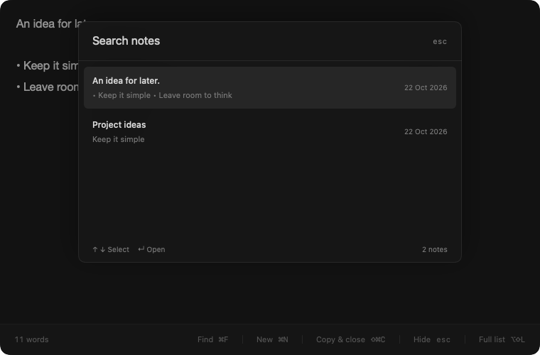

# Drafts guide

[← README](../README.md)

Detailed installation, usage, storage, and development reference for Drafts.

## Install

1. Download **[Drafts-0.9.1-universal.dmg](https://github.com/kush-10/drafts/releases/download/v0.9.1/Drafts-0.9.1-universal.dmg)** from the [official release](https://github.com/kush-10/drafts/releases/tag/v0.9.1).
2. Open the disk image and drag **Drafts** into **Applications**.
3. Eject the disk image, then open Drafts from Applications.
4. Press **⌥Space** to open the notepad; press it again to save and hide. There is **no Dock icon**; Drafts normally lives in the menu bar.

A [ZIP download](https://github.com/kush-10/drafts/releases/download/v0.9.1/Drafts-0.9.1-universal.zip) is available too: extract it, move `Drafts.app` into Applications, then open it. GitHub’s automatically generated **Source code** archives are not app installers.

### First-launch security warning

> **This is an early preview, ad-hoc signed and not Apple-notarized.** macOS may block its first launch. This is not a Developer ID signed or App Store approved release.

If macOS says it cannot verify the developer or check the app for malicious software, and you trust the official download:

1. First try opening Drafts from Applications.
2. Open **System Settings → Privacy & Security**.
3. Find the message about Drafts and click **Open Anyway**, then confirm **Open**. Administrator authentication may be required.

Do **not** disable Gatekeeper globally, bypass a managed Mac’s restrictions, or ignore an actual malware or damaged/modified-app warning. Some macOS versions or organizational policies may not offer an override for ad-hoc builds; in that case, [build from source](#build-from-source) or wait for a Developer ID signed and notarized release.

### Verify a download

Download `SHA256SUMS.txt` from the same release. In Terminal, run this in the folder containing the DMG and compare its hash with the matching line in that file:

```sh
shasum -a 256 Drafts-0.9.1-universal.dmg
```

The release also includes `release-info.json`, which states the version, architectures, signing type, and notarization status. Checksums detect mismatched downloads; they are not an independent developer identity or a replacement for notarization.

## Just a notepad

- A dark, translucent floating editor with no sidebar or formatting toolbar.
- Automatic local saving. Switching apps or clicking outside **keeps the notepad open**; hide it explicitly with the shortcut, Escape, or Copy & close.
- `⌘F` expands to fill the display; press again to restore the previous size and position.
- `⌘K` searches saved note text and topics without running AI. `/Topic` optionally filters a topic.
- `⌥⇧K` opens search directly from any app, even with the notepad hidden.
- The draggable top bar shows word count, All notes, and the note’s topics.
- Optional local MLX AI identifies topics after successful saves. Select and download a model in Settings; no Ollama or server is needed.
- Twenty live-preview themes, including Catppuccin and original Drafts palettes.
- Copy the whole draft and close with one shortcut.
- New Note reuses existing blank drafts instead of filling your history with empties.
- An integrated notes table with filtering, sorting, multiple selection, batch topic assignment, Trash, and restore. Open a row to return to writing in the same window.
- Basic bold, italic, underline, and bullets. No images, code blocks, checklists, tags, accounts, or sync.



*Screenshots use generated sample notes, not personal data.*

## Shortcuts

| Shortcut | Action |
| --- | --- |
| **⌥Space** | Show the **most recently edited** active note when hidden; save and hide when visible, including search. |
| **⌘N** | Open a blank draft, reusing the current or another existing blank. |
| **⇧⌘C** | Copy the whole note as plain text, save, and hide the notepad. |
| **⌘F** | Toggle between the expanded notepad and its previous size and position. |
| **⌘K** | Search note text and saved topics. **↑/↓** selects, **Return** opens. |
| **⌥⇧K** | Open note search from any app, without creating a blank draft. Configurable in Settings. |
| **Esc** | Dismiss search first; otherwise save and hide the notepad. |
| **⌥⇧L** | Show the notes table inside the notepad window. |
| **⌘,** | Settings. |
| **⌘B / ⌘I / ⌘U** | Bold / italic / underline. |
| **⇧⌘B** | Toggle bullet points. |

Show / hide notepad, All notes, and Search notes are global shortcuts. The others work while using Drafts; `⌘F`, `⌘K`, and `⌘,` also work while search is focused. `⌘L` and `⌘S` have no Drafts binding: notes autosave. The search hotkey opens rather than toggles and preserves an existing query. Global bindings can be changed in Settings; conflicting shortcuts are rejected. Standard undo/redo, cut/copy/paste, select all, and close-window commands remain available. `⌘C` is normal selection copy; `⇧⌘C` copies everything.

Return continues a bullet list. Return on an empty bullet exits it. Clipboard contents are **never imported automatically**; explicit paste keeps basic text styles and ignores images.

### Hide the menu-bar icon

Open **Settings → General → Hide menu bar icon**. Drafts continues running without a menu-bar or Dock icon. Use your show/hide shortcut, or reopen Drafts from Applications, then **⌘,** to restore the icon. If a global shortcut cannot register, the menu-bar icon stays visible so you are not locked out.

## Window and note behavior

The notepad initially opens at **760 × 500**, centered on the display containing the pointer. Resize its edges, or drag the **⋯ handle in the top bar** to move it. The top bar remains available in the editor and notes table; buttons and topic controls stay independently clickable. **⌘F** expands to the current display's usable area without creating a separate macOS full-screen Space; press again to restore the previous frame. Selecting or creating notes while visible preserves the window size. After hiding, Drafts remembers its size and expanded state for **30 minutes**, adjustable in Settings. Reopening restores the size, recentred; after expiry it uses the default size. Size memory survives restarting Drafts. The notes table uses the same window and size.

The editor keeps the insertion point visible when opening a long note, navigating to the end, or typing—including an empty final line after a newline. There is extra space beneath the cursor. Resizing and font changes keep an already-visible cursor in view, but ordinary layout/autosave updates do not snap you away from text you have manually scrolled back to read.

The `⌘K` popup searches note text and assigned topic names, ignoring case and accents and matching every search word. Results are ordered by last edit. Escape or clicking the dimmed area **inside the notepad** returns to the underlying view. Selecting an older note does not create a new one or leave expanded mode. Reopening follows the most recently edited active note. Selecting or assigning topics does not change its text-edit timestamp. **Open Note** in the menu and reopening from Applications always open rather than toggle.

Switching to another app/window (for example with **⌘Tab**) or clicking outside **does not hide the notepad or search** and never steals focus back. Autosave continues normally. Explicit hide actions flush pending changes; save failures keep the note open with an error. Settings remains a separate window.

Empty and whitespace-only drafts are reusable. New never overwrites nonblank notes, reuses a note from Trash, or removes pre-existing duplicate files. Previously saved rich text and legacy attachments remain preserved. Existing `#text` is ordinary text, not a tag.

Click **All notes** or press **⌥⇧L** to switch to the table. Search or filter by topic and All/Trash; sort by Note or Edited. Use **⌘/⇧ click** for multiple selection. Batch-add/remove topics, move notes to Trash, or restore them; permanent deletion requires confirmation. Double-click a single active row to return to the editor. Table query, filters and selection survive switching back to writing.

## Local AI topics

**Settings → Models** manages optional, downloadable MLX models; **Organisation** controls save-triggered processing. No weights are bundled, no Ollama/server is required, and nothing is downloaded automatically. Editing and searching work without any installed model. AI requires Apple Silicon.

| Model | Pinned MLX 4-bit download | Minimum unified memory |
| --- | --- | --- |
| Qwen 3 0.6B | ~350 MB | 8 GB |
| Qwen 3.5 0.8B | ~652 MB | 8 GB |
| Llama 3.2 1B Instruct | ~713 MB | 8 GB |
| Gemma 3 1B | ~767 MB | 8 GB |
| Qwen 3 1.7B | ~982 MB | 8 GB |
| Qwen 3.5 2B (lightweight suggestion) | ~1.75 GB | 8 GB |
| Llama 3.2 3B Instruct | ~1.82 GB | 12 GB |
| Qwen 3.5 4B | ~3.1 GB | 12 GB |
| Gemma 3 4B | ~3.44 GB | 16 GB |
| Qwen 3.5 9B (recommended) | ~6.0 GB | 24 GB |
| Qwen 3.5 27B | ~16.1 GB | 48 GB |

Installed models appear first; expand Lightweight / Balanced / Larger to browse the catalogue. Each model has source/licence links and memory guidance. These are download sizes, not runtime RAM requirements or measured accuracy rankings; small models need more review of ambiguous notes. Sizes differ from Ollama/GGUF conversions. Download explicitly from Hugging Face, with progress, cancellation and retry; complete verified files are reused on retry. Repositories/revisions are pinned, and LFS SHA-256 checksums/file sizes are verified before installation. Use **Select** to choose an installed model or **Delete** to remove its files. Catalogue architecture/configuration checks do not replace testing actual inference after a download.

After a **successful content autosave**, Drafts waits three seconds to coalesce saves, queues the latest saved snapshot, loads the selected model, identifies topics and saves only topic metadata. Inference runs serially in a native private MLX helper. Typing takes priority and cancels running analysis; stale, deleted or reconfigured snapshots cannot overwrite current assignments. Failed saves and metadata-only changes never start inference. Missing models and AI failures never block note saving. Analysis does not run on launch, topic assignment or search.

The model unloads after **30 idle seconds** by default, or choose Immediately / 1 minute. Unloading terminates the helper and frees its working memory; it does not delete downloaded files. Switching off **Identify topics after saving** stops automatic organisation and unloads the model. You can still explicitly run **Organise all notes** with automatic processing off. No task extraction, prompt extraction, rewriting, embedding model or `/lookup` inference is included.

**Organise all notes** is available in the All Notes table and Settings → Organisation. It processes the latest saved versions of existing nonblank notes, excluding Trash, with progress and Cancel. It can refresh already-organised notes, preserves manual assignments, never rewrites note text, and never treats model guesses as confirmed memory. Typing pauses/cancels in-flight work and stale snapshots are retried safely. A downloaded, selected model is required; this button never initiates a download.

The model uses exactly five topics and cannot invent names:

- **Mandir:** BAPS/mandir meetings, sabha planning, seva, volunteering and events.
- **University:** modules, academic to-dos, assignments, study notes, research and university meetings.
- **Dev:** software, code, commands, implementation and debugging—not every AI prompt.
- **Scratchpad:** fallback when no domain topic fits; not automatically combined with Mandir/University/Dev.
- **Prompt:** a secondary marker for an AI request on any subject: **Mandir + Prompt**, **University + Dev + Prompt**, or **Scratchpad + Prompt**.

Blank notes stay unlabelled. Full descriptions are editable in Settings and are passed to the model without silent truncation. Existing IDs and manual inclusions/exclusions remain authoritative; **Use automatic topics** resets overrides. The one-time upgrade improves the four original descriptions and adds Prompt without changing note text or existing assignments. Later user description edits are preserved across restarts.

### Assign a topic while writing

In the normal editor, type **`/`** or a partial name such as **`/man`**. Use **↑/↓** to choose a suggestion and **Enter/Tab** (or click) to assign it. The slash command disappears, leaving the rest of the note intact. Repeat to add another topic, such as **Mandir + Prompt**. This is a manual assignment and needs no AI model. **Escape** dismisses suggestions without deleting the text or hiding your notepad. Undo/redo restores both the command text and its manual topic choice. Paths, URLs and unknown slash tokens are left alone. In the search field, `/Topic` still filters results rather than assigning a topic.

### Local topic memory

**Use confirmed notes as topic memory** supplies up to three relevant examples when a saved note is organised. Manual corrections are evidence; use the note’s topic menu → **Remember these topics for similar notes** to confirm an automatic result. Unconfirmed model guesses never teach the model as facts. This is retrieval of human examples, not training model weights, and it does not guarantee higher accuracy.

The bank persists only source note IDs, content fingerprints and explicit positive/negative topic choices, not duplicate note text. Matching excerpts are read locally from saved, unchanged notes; the current note is excluded. Edited, trashed or deleted notes stop being valid examples. **Settings → Topics & Memory** lets you review/forget examples, clear all memory without changing notes or assignments, or turn memory off. Clearing memory does not silently repopulate it on restart. No model runs while gathering or reviewing memory.

### Search (`⌘K`, or global `⌥⇧K`)

Plain search matches note contents and assigned topic names. `/Mandir planning` restricts results to Mandir; `/Mandir /Prompt` finds mandir-related AI prompts. Type `/` for topic suggestions and use Tab/Return to complete. Multiple topic filters require all named topics. Search uses saved metadata only and never loads the model.

## Open at startup

Enable **Settings → General → Startup → Open at startup** to launch Drafts automatically when you log in to this Mac. It is off by default and uses macOS Login Items, without a separate helper or launch agent. Turn the switch off to stop automatic launches; Drafts stays open until you quit it.

If macOS requires approval, use **Open Login Items Settings…** and allow Drafts in **System Settings → General → Login Items**. The setting refreshes when you return to Drafts and respects changes made in System Settings. A pending switch means registration was requested, not that macOS has approved it. Run the installed app from Applications to manage startup.

## Themes

Settings is split into **General, Appearance, Shortcuts, Organisation, Models, Topics & Memory, and Storage** instead of one long page.

**Settings → Appearance** includes a font picker, a **10–40 pt** size control, a live writing preview (including bold/italic and numbers), and Reset. Options use fonts already available on your Mac: System, System Mono, Menlo, Monaco, Helvetica Neue, Avenir Next, Georgia, Palatino, Courier New and Verdana. Unavailable fonts are omitted; an unavailable saved choice falls back to System. Changes preserve text, bold/italic/underline, selection and undo, without bulk-rewriting saved notes.

Expand **Colour theme** for a searchable, live-preview swatch grid with twenty themes: four Catppuccin variants, the original dark look, and fifteen original light/dark Drafts palettes inspired by the supplied theme references. Changes apply to the editor, selection, caret, search, full list, and Settings without resetting text selection or undo history. Credits and upstream licenses are bundled with the app; see [Support/ThemeCredits.txt](../Support/ThemeCredits.txt).

## Storage and privacy

**Your notes stay on this Mac.** Drafts has no accounts, analytics, sync, or clipboard monitoring. MLX inference communicates through private pipes and never sends notes to a service. Network access is used only for model downloads you explicitly request from Hugging Face and its download infrastructure. Drafts does not require Accessibility permission or install outside-click/app-activation monitors.

Notes are stored in:

```text
~/Library/Application Support/Drafts/Notes/
```

Each note is a JSON file with embedded RTFD for formatting and legacy content. Settings → **Storage → Show files** opens the folder. **Back up this folder** for important notes. Storage is not independently encrypted; use FileVault for disk protection.

Topic definitions, manual assignments, organisation status and the metadata-only topic memory bank live in the hidden **`.drafts/`** subfolder of Notes. Include it in backups. Topic metadata can be sensitive and is not independently encrypted. Downloaded models and partial downloads live in **`~/Library/Application Support/Drafts/Models/`**, separately from notes; deleting a model never deletes notes or topics.

New notes are saved before opening. Edits save after a short debounce and flush on note/window switches, hide, sleep, and quit. Save failures retain pending edits in memory and prevent silently closing an unsaved draft. Unreadable files are left untouched.

### Keep everything, or auto-delete

Settings → Storage has two retention choices:

- **Keep everything** (default): nothing is automatically deleted, including Trash.
- **Automatically delete after last edit**: choose a custom number of minutes, hours, or days. Expired notes are **permanently deleted, including Trash**. There is no separate Trash timer or per-note exemption.

The note open in the editor is protected while in use. Merely selecting rows in the table does not protect them from expiry. Hiding an already-expired note can delete it immediately. Copying or reopening does not reset its last-edit time. The cleaner checks on launch, on hide, and every 30 seconds while Drafts runs, and pauses while Settings is open. It does not delete pending changes if saving fails.

Upgrading from the older Trash-based cleanup policy preserves the interval but leaves permanent auto-deletion **off** until explicitly enabled.

## Update or uninstall

To update, quit Drafts from its menu or with **⌘Q**, then replace the app in Applications with the new download. There is no automatic updater. Notes and preferences remain separate from the app bundle.

To uninstall, turn off **Open at startup** if enabled, quit Drafts and move it out of Applications. This does **not** remove your saved notes. If you also want to remove them, back them up first and delete the storage folder in Finder yourself.

## Build from source

Requires **Swift 6.3+ / a compatible full Xcode installation**, selected developer tools, Git, and the **Metal Toolchain** (`xcodebuild -downloadComponent MetalToolchain`). The app targets macOS 14+; local AI requires Apple Silicon. SwiftPM resolves pinned MLX Swift LM and tokenizer dependencies; `Package.resolved` locks transitive versions. Building does not download model weights. No Homebrew runtime, account or API key is needed.

```sh
git clone https://github.com/kush-10/drafts.git
cd drafts
swift test
./scripts/build-app.sh
open /Applications/Drafts.app
```

The default `build-app.sh` builds in temporary staging, verifies/signs the app, safely quits running Drafts copies, and installs **only `/Applications/Drafts.app`**. It checks that note files, manual assignments and downloaded models survive the topic upgrade unchanged before removing old `dist/Drafts.app` and backup app copies. It aborts if Drafts cannot quit safely, and rolls back a failed runtime/configuration check. No permanent backup `.app` is retained. `APP_OUTPUT_DIR=/explicit/staging/path` opts into build-only output for release packaging; clean that staging directory afterwards.

Open `Package.swift` in Xcode, or use `swift run Drafts` for UI development. The complete app includes the native MLX helper, Metal shaders, Swift compatibility libraries and package resources, but no weights. Libraries and the helper are signed before the outer app. Generate versioned DMG/ZIP/checksums with `./scripts/package-release.sh`; see [distribution and notarization instructions](DISTRIBUTION.md). Both executable architectures are verified during packaging; runtime tests run on Apple Silicon, not physical Intel hardware. Intel AI is not supported by the MLX backend.

Tests cover persistence, explicit hiding/save failure, size memory, focus, integrated multi-selection table, text/topic search, shortcuts, fixed topics, human memory, manual overrides, save coalescing, stale/cancelled analysis, file verification, themes and editor/storage behaviours. Tests never download weights. Run installer safety tests with `python3 -m unittest discover -s Tests/InstallerTests -v`. Check the packaged GPU runtime without a model using `/Applications/Drafts.app/Contents/MacOS/DraftsTopicModel --check-runtime`. Actual model inference needs a completed download selected in Settings.

Optional generated sample screenshots:

```sh
DRAFTS_PREVIEW_DIRECTORY="$PWD/.build/previews" swift test --filter WorkflowTests/testViewsRenderAtFixedSizes
```

## Feedback and license

Report bugs in [GitHub Issues](https://github.com/kush-10/drafts/issues), with your macOS version, Mac architecture, and reproduction steps. **Do not upload personal note files or signing credentials.** This preview needs broader testing across Spaces, full-screen apps, multiple monitors, Intel hardware, and older supported macOS versions.

[MIT License](../LICENSE) · Copyright © 2026 Kushal Patel. Independent of other products named Drafts.
